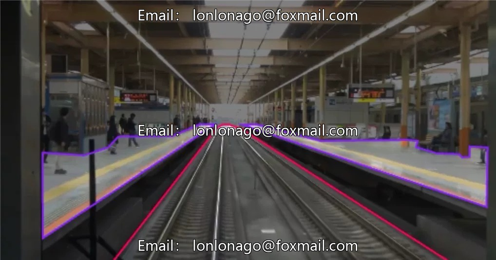
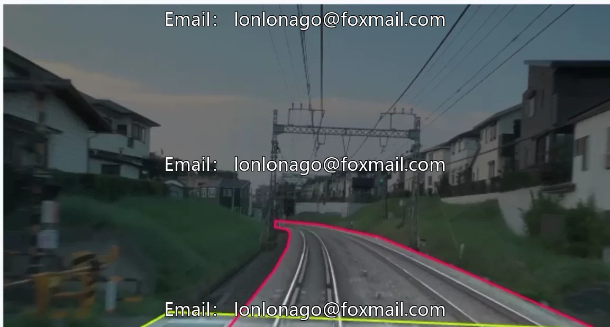
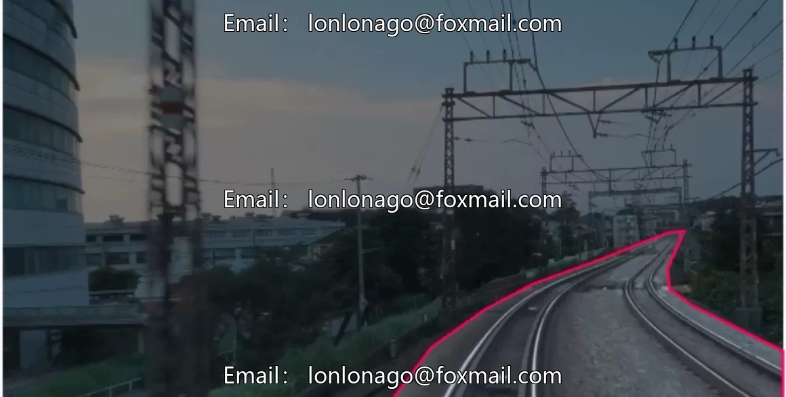
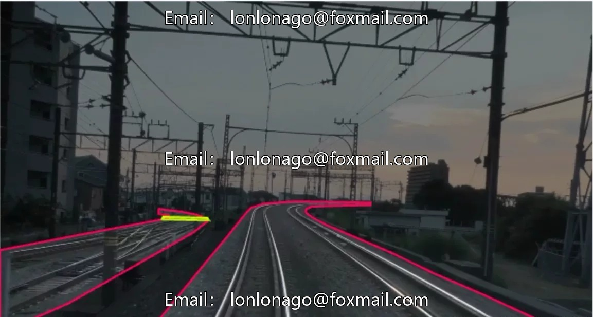
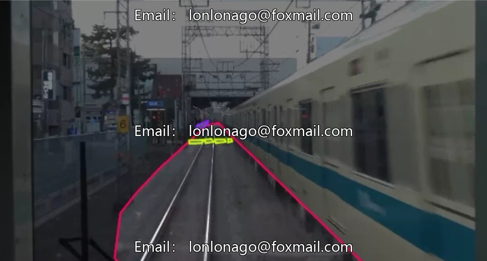

# Intelligent Railway Identification Dataset, comprising 755 images, covering pedestrian walkways, platforms, and tracks.

## Body

Intelligent Railway Identification Dataset, comprising 755 images, covering three core categories of pedestrians, platforms, and tracks, suitable for training and validating railway scene instance segmentation models. The data format is an image file, supports models such as Unet and YOLO, can be directly used in scenarios like railway operation and maintenance, safety monitoring, etc.

The dataset is abundant, meeting the basic model training needs. It comes with 6 datasets and 6 models, forming a complete chain of "image-dataset-model", enhancing the flexibility of training.

Virtual materials, once sold, are non-refundable.
Interested friends, click "I want" to proceed.

## Images

## Payment

Here is a pay link on Stripe ( https://buy.stripe.com/3cs8yP7sY87d0vu9AB ). Please contact me lonlonago@foxmail.com after funding $89, and I will send you a complete data files , thank you!

